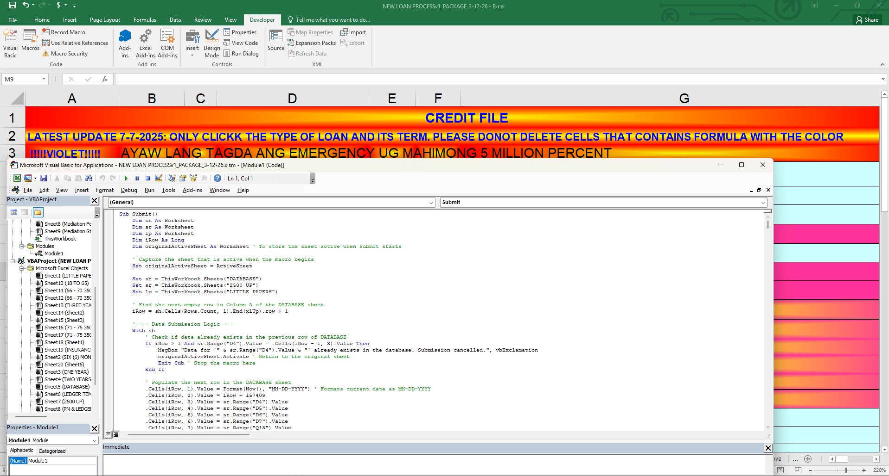

# Loan Processing & Insurance Automation System

Production VBA/Excel platform for a financial cooperative. It covers amortization
schedules and interest calculations, Loan Payment Protection Insurance (LPPI) automated
on the insurer's existing rate structure and print format, voucher-linked loan records
(each loan's total amount is recorded against its assigned voucher number, to be matched
with payment records and the payment schedule), promissory note generation and ledger
reporting. In daily production since 2022; its outputs are used across four roles: loan
processing, cashier, bookkeeping and management.

Individual payments, penalties and partial payments are handled in the cooperative's
legacy ledger by account officers and tellers, not in this workbook. The insurer's rate
table and print format pre-date this project; the work here is the automation around them.

The live workbook is not included here, as it contains confidential member and
financial data. For the analysis behind it (stakeholders, process maps, requirements and
user stories) see the [retrospective case study](../../case-studies/loan-processing-automation).

## Screenshots

Member/loan detail redacted before capture:

Blank credit-file template (test entry, no member data) and a redacted ledger view:

